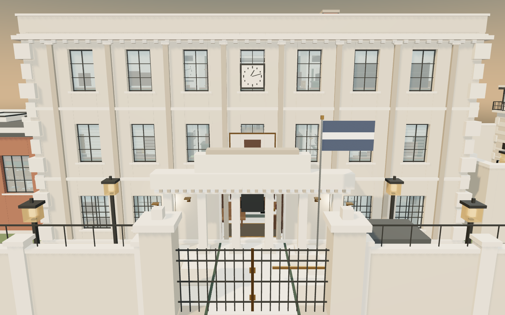
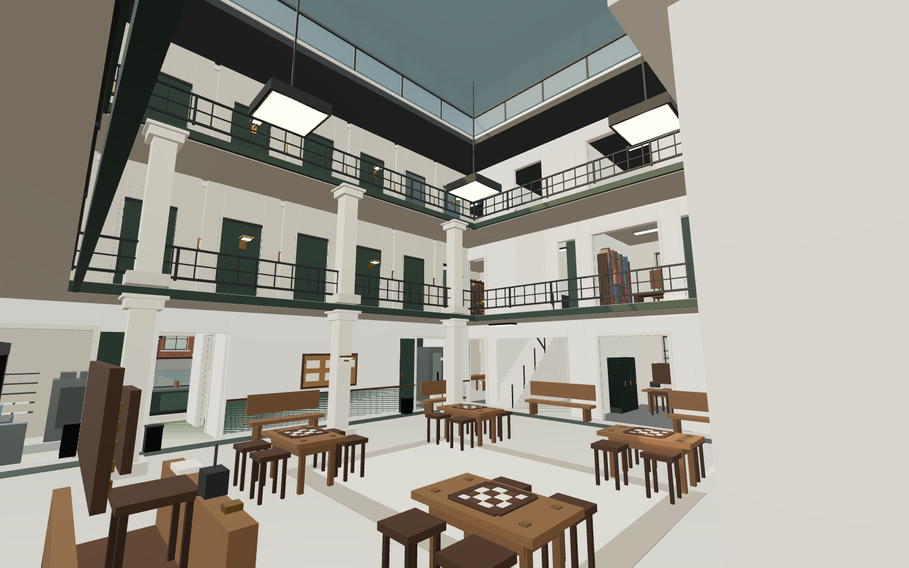
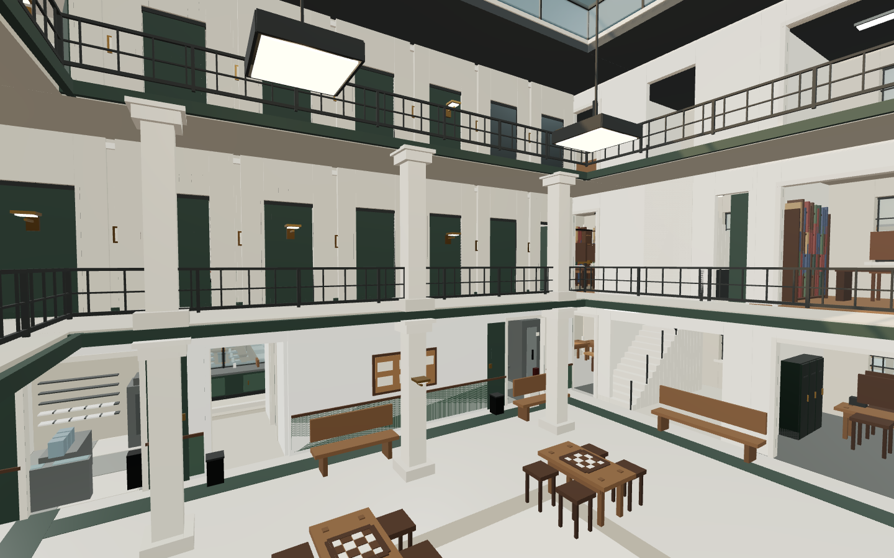
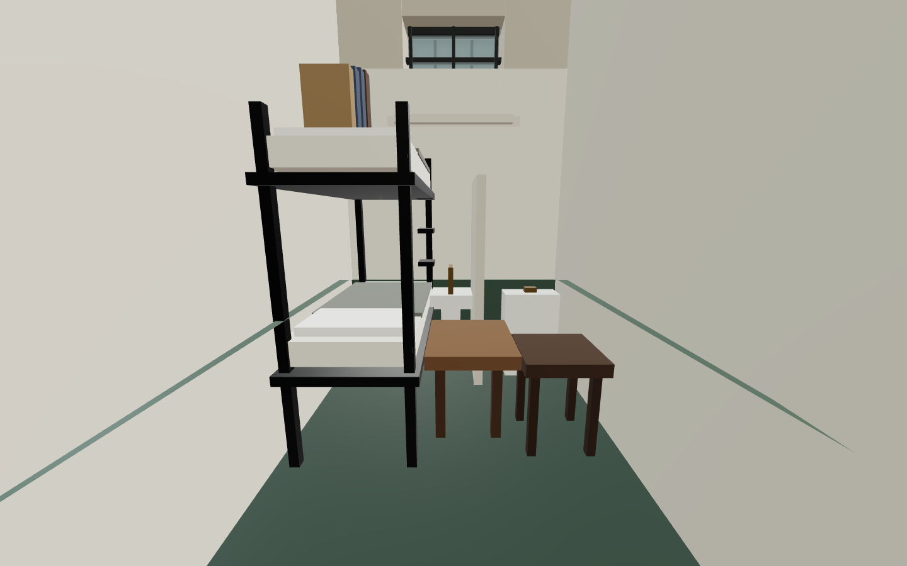
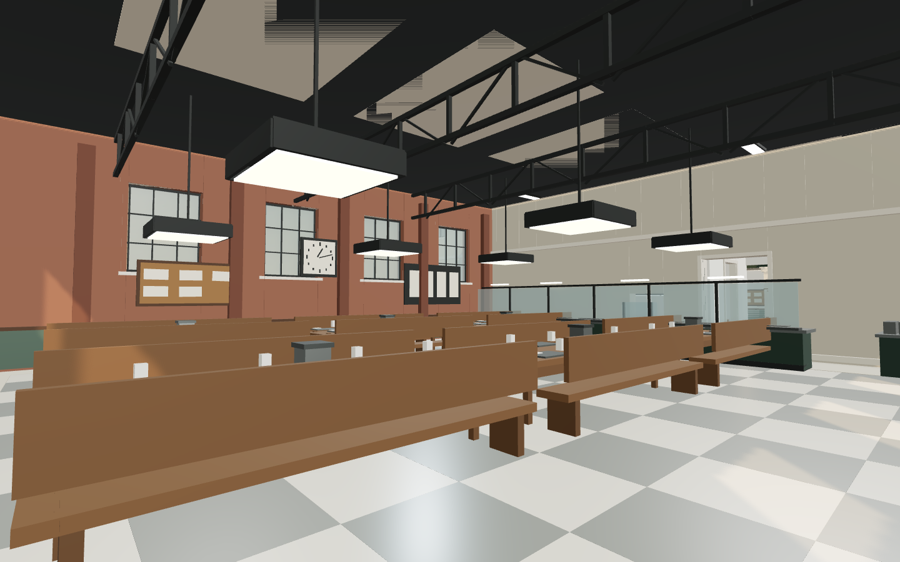
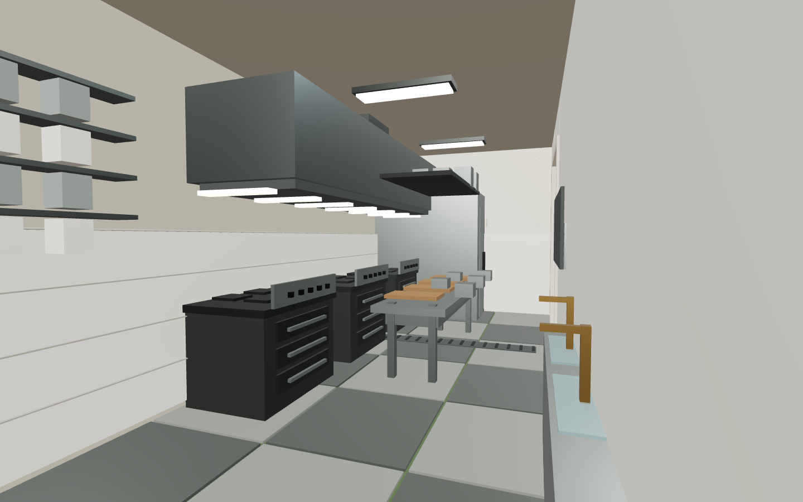
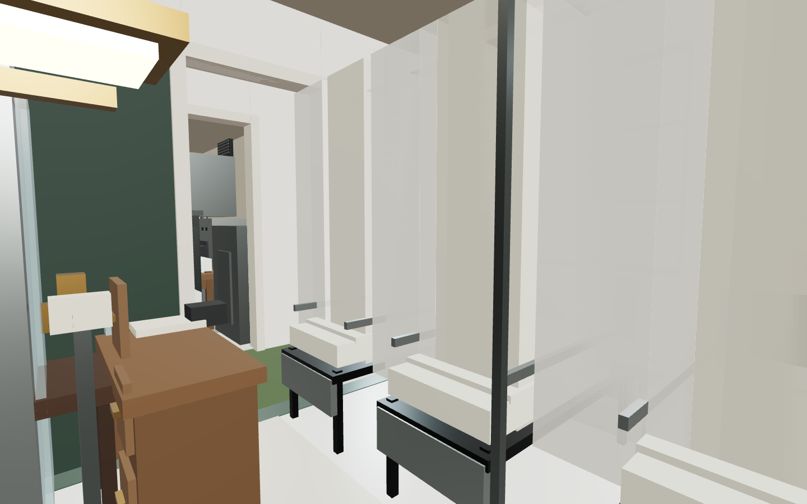
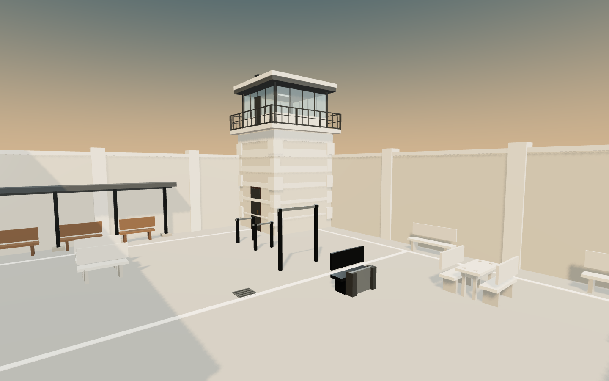

# Presídio Central

**Um showcase de arquitetura prisional clássica, em três pavimentos.**


[](https://github.com/devconnecting1/Jogo-de-Mundo-Aberto-Roblox/actions/workflows/luau.yml)
[](https://github.com/devconnecting1/Jogo-de-Mundo-Aberto-Roblox/actions/workflows/preview.yml)

O Presídio Central é um complexo penitenciário completo em escala real para
Roblox: **três pavimentos, 28 celas nas galerias, 2 celas de triagem, refeitório
para 48 pessoas, cozinha industrial, lavanderia, enfermaria, administração,
biblioteca, capela, oficina, pátio murado e torre de vigia**.

São **9.455 peças (Parts) retangulares** e **142 luzes práticas**, todas geradas
de forma determinística por código Luau. Não há cilindros, esferas, wedges,
malhas, NPCs, interfaces de gameplay, áudio, veículos ou assets de terceiros.
O lugar é um ambiente estático e explorável, pensado para ser aberto no Studio
e receber sistemas depois.

## O complexo

|                                                                              |                                                                                |
| ---------------------------------------------------------------------------- | ------------------------------------------------------------------------------ |
|                                        |                                              |
| **Fachada principal** — cantaria, pórtico, cornijas, relógio e janelas altas | **Átrio** — três galerias de ferro, lanternim de vidro e pendentes industriais |

O edifício principal ocupa **80 × 84 studs** (cerca de 22,4 × 23,5 m) e tem
**1.580 m² construídos** em três pavimentos de 13 studs (3,64 m) entre pisos,
com pé-direito livre de aproximadamente 3,4 m. O refeitório anexo soma
**255 m²** e pé-direito de 5,6 m. O terreno fechado tem **2.038 m²**.

### Térreo — acesso, serviço e convivência

- **Entrada pública:** pórtico, porta dupla, detector de metais, recepção e
  banco de espera. O acesso é único e controlado.
- **Visitas:** quatro cabines com vidro de segurança, telefones bilaterais,
  balcões e área pública separada da circulação dos detentos.
- **Triagem:** balcão de registro, quadro de altura, câmera, armários de
  pertences e **2 celas de espera** com porta de ferro.
- **Hall central:** 52 × 54 studs sob o átrio, com posto de guarda, quadro de
  chaves, mesas de jogos, bancos e acesso a todas as alas.
- **Refeitório:** seis mesas de carvalho para 48 lugares, piso xadrez, balcão
  de serviço com proteção de vidro, passagem aquecida da cozinha, tesouras
  metálicas e três lanternins.
- **Cozinha industrial:** três fogões, coifa, ilha de preparo, câmara fria,
  passagem para o refeitório, copa, lava-louças, tríplice cuba e despensa.
- **Lavanderia:** quatro lavadoras industriais, secadoras empilhadas, mesas de
  triagem, carrinhos, prateleiras de roupa e tubulação de vapor.
- **Enfermaria:** três leitos hospitalares, cortinas de privacidade, posto de
  enfermagem, armário de medicamentos com vidro, lavatório e suporte de soro.
- **Oficina e casa de máquinas:** bancadas de carpintaria, gaiola de
  ferramentas, caldeira, gerador, tanque de água, quadros elétricos e bombas.
- **Pátio:** 383 m² de concreto, quadra de handebol, abrigo de sombra,
  equipamentos de ginástica, guarita e **torre de vigia** com refletor.

### Primeiro pavimento — 14 celas e administração

- **Galerias oeste e leste:** sete celas por lado, portas de ferro com janela
  de observação, seteira e placa, abertas para um corredor de 8 studs.
- **Biblioteca:** estantes de madeira, mesas de leitura, fichário e escada de
  bibliotecário.
- **Sala de aula:** oito carteiras, quadro-negro, mapa, mesa do professor e
  estante didática.
- **Gabinete do diretor:** mesa de nogueira, poltrona de couro, estante, cofre,
  tapete e persianas.
- **Escritório de pessoal:** mesas, máquinas de escrever, arquivos, armários e
  bebedouro.
- **Controle:** mesa de rádio, painel de chaves, quadro de plantão, armários e
  arquivo.
- **Chefe de guarda:** mesa, estante, armários e mural.

### Segundo pavimento — 14 celas, capela e arquivo

- **Galerias oeste e leste:** mais sete celas por lado, com as mesmas portas e
  a mesma lógica de vigilância do pavimento inferior.
- **Capela:** altar de pedra, cruz de madeira, seis bancos, vitrais coloridos,
  castiçais, genuflexório e grade do altar.
- **Arquivo morto:** estantes de ferro, caixas de processos e mesa de consulta.
- **Alojamento de plantão:** camas, mesa, armários, cozinha de apoio e mural.
- **Registro:** estantes de fichas, caixas de registro, mesa de consulta e
  escada de arquivo.
- **Arquivo administrativo:** estantes, caixas, mapoteca e desumidificador.

### As celas

Cada cela das galerias tem cerca de **6,8 m²**, piso lavável, paredes claras com
faixa verde institucional, cama ou beliche, sanitário, lavatório, espelho,
prateleira, luz de teto protegida e **janela alta gradeada** para luz e
ventilação. As celas de isolamento são mais austeras: cama baixa, janela
vedada e porta maciça com seteira.

A população é variada de propósito:

- **13 celas individuais**, **11 com beliche**, **3 de isolamento** e **1 de
  confiança**;
- As celas de isolamento ficam no segundo pavimento, com janela vedada e porta
  maciça com seteira;
- **4 celas com porta aberta** para inspeção visual no preview;
- **2 celas de espera** na triagem.

|                                                                       |                                                                |
| --------------------------------------------------------------------- | -------------------------------------------------------------- |
|                                 |                                |
| **Galeria** — portas de ferro, arandelas e guarda-corpo sobre o átrio | **Cela 109** — beliche, sanitário, lavatório e janela gradeada |

## Refeitório e serviço de alimentação

O refeitório fica no anexo oeste, ligado ao edifício principal por uma passagem
controlada e por uma janela de serviço aquecida. A cozinha é uma galeria de
12,5 × 35 studs com fluxo linear: recebimento e câmara fria ao norte, cocção no
centro, copa e lava-louças ao sul. Essa separação evita cruzamento entre
alimentos crus, pratos sujos e a linha de servir.

|                                                                 |                                                           |
| --------------------------------------------------------------- | --------------------------------------------------------- |
|                     |                     |
| **Refeitório** — 48 lugares, piso xadrez, tesouras e lanternins | **Cozinha** — fogões, coifa, ilha, câmara fria e passagem |

## Decisões de projeto

O layout segue uma leitura realista de segurança prisional, sem transformar o
showcase em um jogo:

- **Setorização progressiva:** público → triagem → circulação segura → galerias
  de celas. O visitante nunca atravessa a área de detentos.
- **Controle de acesso único:** portão principal, guarita, sally port e portão
  do pátio criam barreiras sucessivas.
- **Linhas de visão:** o posto de guarda no hall e o chefe de guarda no centro
  da ala norte enxergam as escadas e as galerias. O pátio tem torre de vigia e
  refletores.
- **Celas salubres:** iluminação natural alta, ventilação cruzada, sanitário e
  lavatório individuais e piso lavável.
- **Circulação separada:** administração e visitas ficam na ala sul; cozinha,
  lavanderia e enfermaria ficam no térreo; celas e capela nos pavimentos altos.
- **Serviço adjacente:** cozinha ao lado do refeitório, lavanderia perto da
  roupa de cama e enfermaria perto do acesso de veículos.
- **Linguagem clássica:** cantaria de calcário, tijolo, ferro fundido, madeira
  de lei, terrazzo e pintura verde de repartição. A ornamentação é contida:
  cornijas, pilastras, dentículos, esquadrias altas e grades de seção quadrada.
- **Somente Parts:** toda a geometria é retangular. Não há cilindros, esferas,
  wedges ou malhas — nem nas grades, nos vitrais ou nas luminárias.
- **Escala:** 1 stud ≈ 0,28 m. Portas de 2,8 m, celas de 6,8 m², refeitório de
  5,6 m de altura e um complexo que caiba no orçamento de um lugar Roblox.

## Abrir no Roblox

O projeto usa **Rojo + Luau**, com o mapa gerado de forma determinística por
**Lune**. O arquivo pronto também é produzido no CI.

### Opção 1 — baixar o lugar compilado

1. Abra a aba **Actions** do repositório.
2. Selecione o workflow **Luau & Rojo** mais recente.
3. Baixe o artefato **PrisaoCentral-place**.
4. Abra `PrisaoCentral.rbxlx` no Roblox Studio e pressione **Play**.

### Opção 2 — compilar localmente

Requisitos: [Rokit](https://github.com/rojo-rbx/rokit), Roblox Studio e Node 22
(opcional, apenas para o preview).

```bash
rokit install
lune run tools/build_world.luau
lune run tools/export_scene.luau
mkdir -p build
rojo build default.project.json -o build/PrisaoCentral.rbxlx
```

O comando `rojo serve` também funciona para iterar no Studio, mas o mapa é
estático e já está embutido no lugar gerado.

## Visualizador 3D de revisão

O diretório `preview/` contém um visualizador web independente, com órbita,
pontos de vista prontos, maquete sem teto e controle das camadas do complexo.
Os renders de revisão são gerados pelo mesmo pipeline a partir de
`preview/scene.json`:

```bash
npm ci
npm run preview
# http://localhost:4173
```

Há **9 pontos de vista**: maquete, fachada, átrio, galeria, cela, refeitório,
cozinha, enfermaria e pátio. Para regerar as imagens:

```bash
npm run render:previews
```

O visualizador é uma ferramenta de revisão, não faz parte do jogo.

|                                                |                                                   |
| ---------------------------------------------- | ------------------------------------------------- |
|    |                 |
| **Enfermaria** — três leitos, cortinas e posto | **Pátio** — quadra, abrigo, ginástica e muro alto |

## Publicação segura no Roblox

O workflow **Publicar no Roblox** usa a Open Cloud API e roda de duas formas:

- **Automática:** quando o workflow **Luau & Rojo** passa em um push para
  `main`, ele baixa o artefato já validado e publica com `versionType=Published`.
  Na prática, fazer merge na `main` atualiza a experiência sem abrir o Studio.
- **Manual:** em **Actions → Publicar no Roblox → Run workflow** é possível
  escolher `Saved` (apenas salva) ou `Published` (vai ao ar).

Credenciais nunca entram no repositório. Antes de usar, configure em
**Settings → Secrets and variables → Actions**:

| Tipo     | Nome                 | Conteúdo                                              |
| -------- | -------------------- | ----------------------------------------------------- |
| Variable | `ROBLOX_UNIVERSE_ID` | ID do universo da experiência                         |
| Variable | `ROBLOX_PLACE_ID`    | ID do lugar                                           |
| Secret   | `ROBLOX_API_KEY`     | chave da Open Cloud com permissão de escrita no lugar |

A chave é mascarada pelo GitHub durante a execução. Se quiser aprovar cada
deploy, adicione revisores ao environment `roblox-production` em
**Settings → Environments**.

> **Importante:** qualquer chave que já tenha sido compartilhada em texto deve
> ser revogada e substituída. Cadastre uma chave nova somente pelo cofre de
> secrets do GitHub, nunca em commits, issues ou arquivos do projeto.

## Como o projeto é feito

```text
src/builder/           compilador do presídio em Luau (executado pelo Lune)
  Architecture.luau    casca, átrio, galerias, escadas, fachadas e refeitório
  Cells.luau           celas, portas de ferro, beliches, isolamento e confiança
  Hall.luau            hall central, posto de guarda e mobiliário de convivência
  Refeitorio.luau      mesas, balcão, proteção, tesouras e pendentes
  Cozinha.luau         cocção, câmara fria, copa, lava-louças e despensa
  Lavanderia.luau      máquinas, triagem, carrinhos e vapor
  Enfermaria.luau      leitos, cortinas, posto e armário de medicamentos
  Visitas.luau         cabines, vidro, telefones e público
  Triagem.luau         registro, pertences e celas de espera
  Administracao.luau   entrada, diretoria, escritórios, controle e plantão
  Biblioteca.luau      biblioteca, sala de aula e mobiliário
  Capela.luau          capela, vitrais e arquivo morto
  Oficina.luau         carpintaria, gaiola de ferramentas e casa de máquinas
  Patio.luau           pátio, guarita, torre de vigia e equipamentos
  Grounds.luau         terreno, muros, portões e paisagismo
  Kit.luau             helpers de peças, grades, corrimãos e luzes
  Furniture.luau       mesas, camas, estantes, portas e luminárias
  Palette.luau         paleta fechada de materiais clássicos
  Layout.luau          planta, níveis, alas e escala
  Prison.luau          orquestrador do complexo
src/world/             PrisaoCentral.rbxm gerado e versionado
tools/                 geração do modelo, export do preview e validação do place
tests/                 testes de navegabilidade, geometria e preview
preview/               visualizador Three.js e cena exportada
.github/workflows/     CI, preview e publicação automática/manual no Roblox
```

### Pipeline

1. `tools/build_world.luau` monta o presídio com Lune e serializa
   `PrisaoCentral.rbxm`.
2. `default.project.json` combina o modelo com as configurações do lugar:
   `Lighting` em Future, atmosfera, bloom, color correction, spawn e
   StarterPlayer.
3. `rojo build` produz o `.rbxlx` final.
4. `tools/export_scene.luau` exporta a mesma geometria para o preview web.
5. Os workflows validam tudo em `ubuntu-latest`.

### Testes

- **Testes do presídio (Lune):** 14 verificações que cobrem:
  - modelo raiz, ambientes e atributos;
  - somente Parts retangulares, ancoradas, sem scripts, NPCs ou UIs;
  - 28 celas + 2 celas de triagem, com cama, sanitário, lavatório e porta;
  - refeitório com 48 lugares, seis mesas e cozinha/lavanderia/enfermaria
    equipadas;
  - grades, portas, vidros, escadas e três pavimentos;
  - **navegabilidade 2D com avatar de raio 0,85 stud** em cada pavimento,
    verificando 28 destinos nos três pavimentos: hall, refeitório, cozinha,
    lavanderia, enfermaria, visitas, triagem, oficina, casa de máquinas, pátio,
    galerias, ponte sul, biblioteca, sala de aula, diretoria, escritório,
    controle, chefe de guarda, capela, arquivo morto, alojamento, registro,
    arquivo e plantão.
- **Validação do lugar final:** abre o `.rbxlx` produzido pelo Rojo e confere
  modelo, iluminação, atmosfera, spawn, ausência de scripts/NPCs/UIs e apenas
  Parts retangulares.
- **Testes do preview:** integridade das matrizes, materiais, camadas, arquivos
  PNG e metadados, mais testes end-to-end com Playwright.
- **ESLint e Prettier:** executados exclusivamente no GitHub Actions, conforme
  o escopo desta entrega.
- **Cache e dependências:** a toolchain Rojo/Lune é cacheada por uma composite
  action, o npm usa o cache do `setup-node` e o Chromium é cacheado pelo
  `package-lock.json`. O Dependabot agrupa atualizações semanais de npm e
  GitHub Actions em PRs revisáveis.

## Automação no GitHub Actions

Todo o CI usa **runners padrão `ubuntu-latest`** e é gratuito para repositórios
públicos. Não há runner maior, serviço pago ou recurso de terceiros. Os
workflows têm permissões mínimas, `concurrency` para cancelar execuções antigas
e cache da toolchain Roblox, do npm e do Chromium.

| Workflow                 | Gatilho             | O que faz                                                                |
| ------------------------ | ------------------- | ------------------------------------------------------------------------ |
| **Luau & Rojo**          | push e pull request | gera o modelo e a cena, roda os 14 testes, compila e valida o place      |
| **Preview & JavaScript** | push e pull request | ESLint, Prettier, testes unitários e Playwright                          |
| **Render de revisão**    | manual              | renderiza os 9 pontos de vista (ou IDs escolhidos) e publica um artifact |
| **Publicar no Roblox**   | após o CI na `main` | publica o place validado; também aceita execução manual                  |

O workflow **Render de revisão** é manual de propósito: renderizar nove imagens
consome mais tempo do que o CI normal e as imagens só precisam ser regeradas
quando a geometria ou as câmeras mudam. Ele aceita, por exemplo, `atrio cela`
para refazer apenas dois pontos de vista. O artifact fica disponível por 14
dias; para aparecer no README ou no PR, as imagens precisam ser commitadas,
porque URLs de artifact não são imagens públicas cruas.

Recomendação de uso: deixe lint, testes, Playwright e validação do lugar com o
GitHub Actions; rode localmente apenas o subconjunto rápido e os renders que
serão commitados. O CI é a fonte de verdade para o merge.

## Contribuição e agentes

As regras completas do repositório, o mapa dos módulos, o fluxo de build, os
critérios de qualidade e o que não fazer estão em [AGENTS.md](AGENTS.md). Ele é
o guia universal para pessoas e agentes de IA; `CLAUDE.md` e
`.github/copilot-instructions.md` apenas apontam para lá. O skill
`.claude/skills/presidio-build/SKILL.md` resume o caminho operacional para
alterações de geometria e preview.

## Limites de escopo

Não foram implementados UI de gameplay, NPCs, inventário, missões, áudio,
interações com portas ou sistemas de facção. O presídio é o entregável: um
lugar estático e explorável, com celas, galerias, refeitório, serviços,
administração, capela, pátio e torre de vigia. Os controles padrão do Roblox
continuam ativos.

As imagens deste README são renders de revisão feitos no visualizador web a
partir da mesma geometria exportada. Elas não são screenshots do motor do
Roblox, embora o lugar final use a geometria, os materiais e a iluminação
equivalentes.

## Créditos

Construído com Luau, Rojo, Lune e Three.js (MIT). Todas as formas, materiais,
plantas e composições são originais e geradas por código neste repositório.
