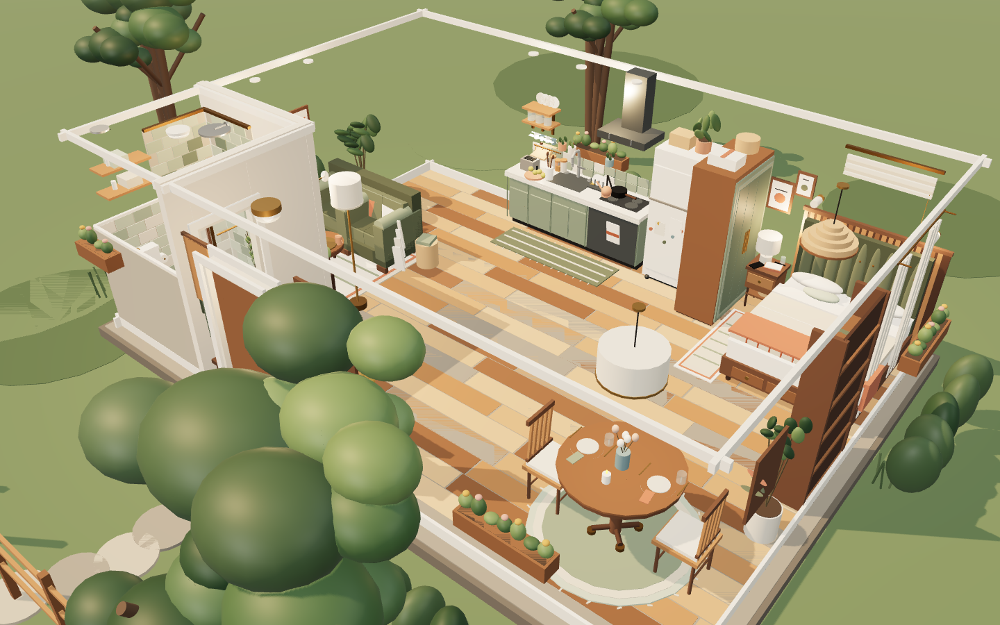
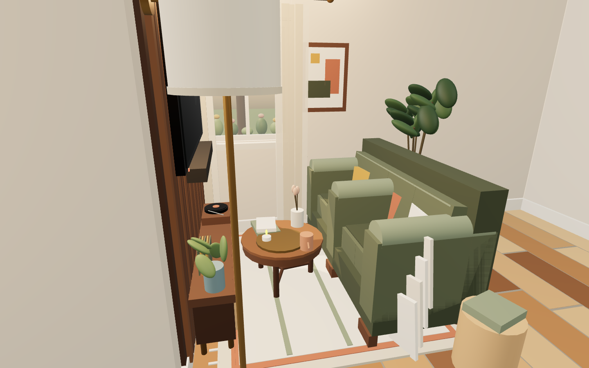
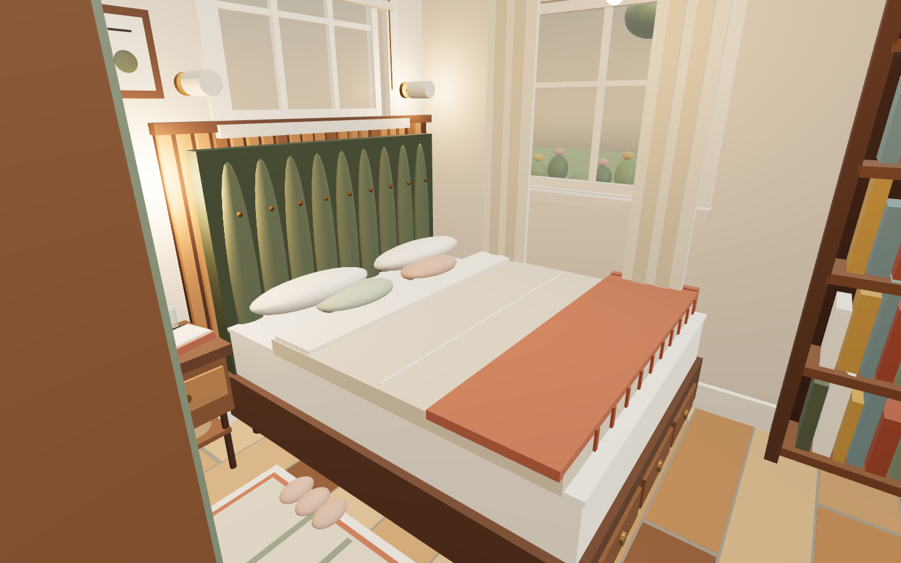
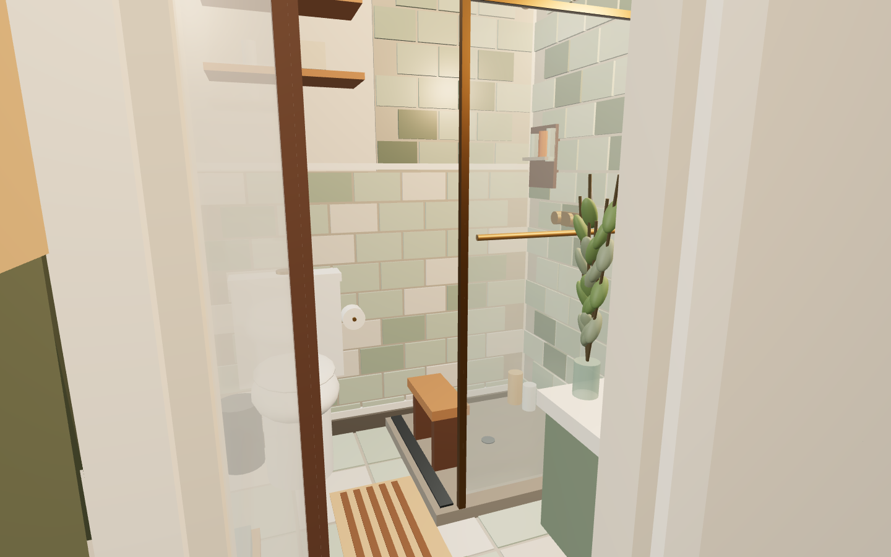
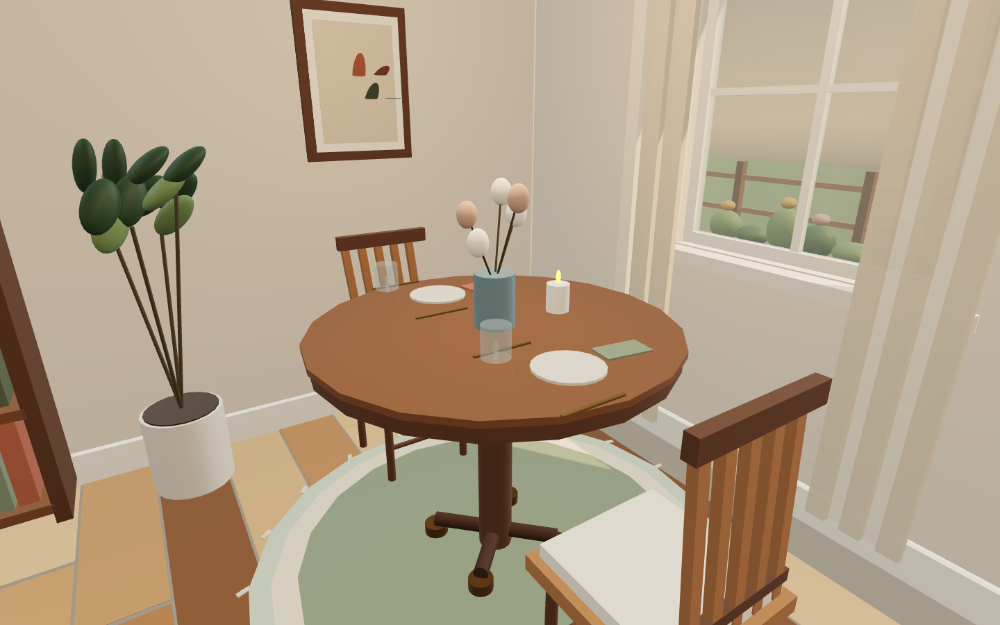
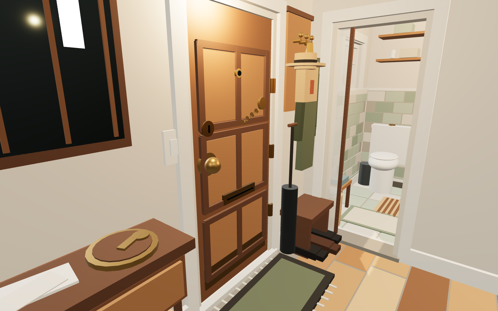

# Casa 27

**Um mundo aberto do tamanho de uma casa.**



[](https://github.com/devconnecting1/Jogo-de-Mundo-Aberto-Roblox/actions/workflows/luau.yml)
[](https://github.com/devconnecting1/Jogo-de-Mundo-Aberto-Roblox/actions/workflows/preview.yml)

A Casa 27 é um interior 3D em escala real, pensado para Roblox. São **44 m² de casa
compacta**, com pé-direito de 2,58 m, construída inteiramente com primitivas de
Roblox e organizada como um único espaço contínuo e explorável: sala, cozinha
aberta, canto de dormir, banheiro minúsculo, entrada e canto de jantar.

Não há UI própria, NPCs, missões ou scripts de gameplay. O lugar é um ambiente
jogável, estático e detalhado, pronto para receber sistemas depois — exatamente
o recorte pedido para esta entrega.

## Por dentro da casa

| | |
| --- | --- |
|  |  |
| **Sala** — sofá de linho, parede ripada, TV, toca-discos, tapete e claraboia | **Cozinha** — armários shaker, bancada de pedra, forno, coifa, geladeira retrô e geladeira cheia de ímãs |
|  |  |
| **Quarto** — cama de casal, cabeceira estofada, guarda-roupa e janelas com linho | **Banheiro** — zellige verde-água, box de vidro, cuba de cerâmica e ferragens de latão |
|  |  |
| **Jantar** — mesa de nogueira para duas pessoas, cadeiras de palhinha e estante | **Entrada** — porta de madeira com ferragens, capacho, espelho, ganchos e banco de sapatos |

### O que foi desenhado

- **Escala real:** 1 stud ≈ 0,28 m, com portas de 2,0 m, bancada de 0,84 m,
  cama de casal de 1,51 × 1,82 m e pé-direito de 2,58 m.
- **Casa apertada, não um galpão:** 44 m² com circulação central, cantos de
  permanência e mobiliário desenhado para cada centímetro.
- **Luz natural:** lanternim central com quatro vidros, sete janelas, caixilhos
  com bandeiras, peitoris de pedra e cortinas de linho.
- **Luz prática:** pendentes, spots, arandelas, fita de LED na bancada,
  luminária de pé e luz de leitura, todas com temperatura quente.
- **Materiais:** madeira de lei nos móveis, carvalho no piso, zellige no
  banheiro, mármore na cozinha, palhinha, linho, cerâmica, latão e vidro.
- **Detalhes vividos:** 2.226 peças, louças, livros, discos, plantas, mantas,
  almofadas, ferragens, potes, ímãs na geladeira e um banheiro funcional em
  3,2 m².
- **Zero assets de terceiros:** nenhuma imagem, malha ou ID de Marketplace.
  Tudo é gerado a partir de código Luau.

As imagens acima são renders de revisão feitos no visualizador web a partir da
mesma geometria exportada. Elas não são screenshots do motor do Roblox, embora
o lugar final use a geometria, os materiais e a iluminação equivalentes.

## Abrir no Roblox

O projeto foi feito para o fluxo **Rojo + Luau**, com o mapa gerado de forma
determinística por **Lune**. O arquivo pronto também é produzido no CI.

### Opção 1 — baixar o lugar compilado

1. Abra a aba **Actions** do repositório.
2. Selecione o workflow **Luau & Rojo** mais recente.
3. Baixe o artefato **Casa27-place**.
4. Abra `Casa27.rbxlx` no Roblox Studio e pressione **Play**.

### Opção 2 — compilar localmente

Requisitos: [Rokit](https://github.com/rojo-rbx/rokit), Roblox Studio e Node 22
(opcional, apenas para o preview).

```bash
rokit install
lune run tools/build_world.luau
lune run tools/export_scene.luau
mkdir -p build
rojo build default.project.json -o build/Casa27.rbxlx
```

O comando `rojo serve` também funciona para iterar no Studio, mas o mapa é
estático e já está embutido no lugar gerado.

## Visualizador 3D de revisão

O diretório `preview/` contém um visualizador web independente, com Órbita,
pontos de vista prontos, maquete sem teto e controle das camadas da casa.

```bash
npm ci
npm run preview
# http://localhost:4173
```

O visualizador carrega `preview/scene.json`, gerado pelo pipeline a partir do
mesmo modelo do Roblox. Ele é uma ferramenta de revisão, não faz parte do jogo.

## Publicação segura no Roblox

O workflow **Publicar no Roblox** usa a Open Cloud API e é disparado
manualmente. Credenciais nunca entram no repositório.

Antes de usar, configure em **Settings → Secrets and variables → Actions**:

| Tipo | Nome | Conteúdo |
| --- | --- | --- |
| Variable | `ROBLOX_UNIVERSE_ID` | ID do universo da experiência |
| Variable | `ROBLOX_PLACE_ID` | ID do lugar |
| Secret | `ROBLOX_API_KEY` | chave da Open Cloud com permissão de escrita no lugar |

Depois, abra **Actions → Publicar no Roblox → Run workflow**. O padrão é
`Saved`; escolha `Published` quando quiser levar a versão ao ar. A chave é
mascarada pelo GitHub durante a execução.

> **Importante:** qualquer chave que já tenha sido compartilhada em texto deve
> ser revogada e substituída. Cadastre uma chave nova somente pelo cofre de
> secrets do GitHub, nunca em commits, issues ou arquivos do projeto.

## Como o projeto é feito

```text
src/builder/           compilador da casa em Luau (executado pelo Lune)
  Architecture.luau    paredes, piso, teto, janelas, claraboia e molduras
  Kitchen.luau         cozinha completa
  Living.luau          sala, TV, sofá e plantas
  Bedroom.luau         quarto e guarda-roupa
  Bathroom.luau        banheiro, box e revestimentos
  Dining.luau          jantar, estante e arte
  Entry.luau           entrada, porta, capacho e arrumação
  Exterior.luau        jardim, árvores, sebes e varanda
src/world/             Casa27.rbxm gerado e versionado
src/builder/Kit.luau   helpers de peças, cilindros, luzes e molduras
tools/                 geração do modelo, export do preview e validação do place
tests/                 testes de navegabilidade, geometria e preview
preview/               visualizador Three.js e cena exportada
.github/workflows/     CI, preview e publicação manual no Roblox
```

### Pipeline

1. `tools/build_world.luau` monta a casa com Lune e serializa `Casa27.rbxm`.
2. `default.project.json` combina o modelo com as configurações do lugar:
   `Lighting` em Future, atmosfera, bloom, color correction, spawn e StarterPlayer.
3. `rojo build` produz o `.rbxlx` final.
4. `tools/export_scene.luau` exporta a mesma geometria para o preview web.
5. Os workflows validam tudo em `ubuntu-latest`.

### Testes

- **Testes da casa (Lune):**
  - geometria ancorada e sem scripts;
  - contagem e distribuição de mobiliário por ambiente;
  - luzes, vidros, portas e spawn;
  - limites espaciais e escala;
  - navegabilidade 2D com um avatar de raio 0,85 stud, em grade de 0,25 stud,
    verificando acesso à sala, cozinha, banheiro, quarto e jantar.
- **Validação do lugar final:** abre o `.rbxlx` produzido pelo Rojo, confere
  modelo, iluminação, atmosfera, spawn e ausência de scripts.
- **Testes do preview:** integridade das matrizes, materiais, camadas, arquivos
  PNG e metadados, mais testes end-to-end com Playwright.
- **ESLint e Prettier:** executados exclusivamente no GitHub Actions, conforme
  o escopo desta entrega. Não há hooks ou tarefas locais de lint/formatação.

## Limites de escopo

Não foram implementados UI de gameplay, NPCs, inventário, missões, áudio ou
interações com portas. A casa é o entregável: um lugar estático e explorável,
com portas fechadas, persianas, marcenaria, louças e ambientação para receber
gameplay em uma próxima etapa. Os controles padrão do Roblox continuam ativos.

## Créditos

Construído com Luau, Rojo, Lune e Three.js (MIT). Todas as formas, materiais e
composições são originais e geradas por código neste repositório.
